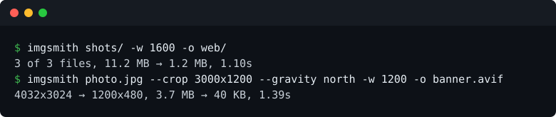

# imgsmith

Convert, resize, crop and thumbnail images with one 6.6 MB binary. No ImageMagick, no delegates, nothing behind it.



```
cargo install imgsmith
brew install marceanlabs/imgsmith/imgsmith
```

Prebuilt binaries for Linux, macOS and Windows are on the [releases page](https://github.com/marceanlabs/imgsmith/releases). The musl build is one static file.

## What it does

- **convert** between PNG, JPEG, WebP, AVIF, TIFF, GIF, BMP, ICO, TGA, PNM, QOI, HDR, EXR and farbfeld.
- **resize** with four fits: `inside`, `outside`, `fill`, `cover`. Then crop with gravity, rotate, flip.
- **batch** a folder, walked recursively, one summary line at the end.
- **read** the camera data with `--info`, or rename files by the date taken with `--rename-by-date`.
- The order is fixed: upright, crop, resize, rotate. A crop always refers to the photo as you see it, not as the camera saved it.

Exit codes: 0 every file written, 1 at least one failed, 2 the arguments were wrong.

## Measured

| | |
|---|---|
| 12 megapixel JPEG to 1920 wide | 11% quicker than ImageMagick 7.1.2 |
| Install size | 6.6 MB, against 25 packages and 67 MB |
| Three 4 megapixel photos to 1600 wide | 11.2 MB to 1.2 MB in 1.1 s |

Method, full table and the two places where it is not the faster tool: [BENCHMARKS.md](BENCHMARKS.md).

## What it will not do

- PDF, PostScript, SVG. Those need a renderer, and there is nothing behind this binary.
- Animated GIF, APNG or WebP: it stops rather than saving the first frame.
- HEIC, or AVIF reading. Writing AVIF works, reading it needs a C decoder.
- Lossy WebP. `--quality` with WebP is an error, not a number that gets ignored.
- Filters, text, colour management, plugins, network.

## From Rust

Every command is also a function.

```rust
use imgsmith::{process, Format, Options};

let opts = Options { width: Some(1920), ..Options::default() };
process("photo.jpg".as_ref(), "photo.webp".as_ref(), Format::Webp, &opts, false)?;
```

Nothing is overwritten without `--force`, output is written to a temporary file and renamed, and images over 100 megapixels are refused before decoding.

## Licence

Apache-2.0. Free to use, and there is no plan to charge for it.
